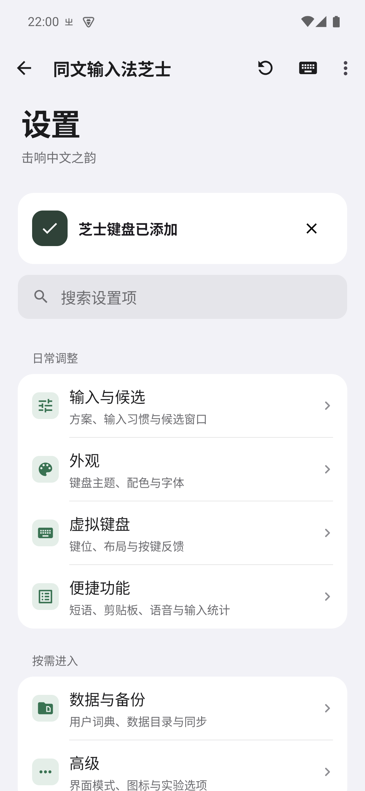

<!--
SPDX-FileCopyrightText: 2015 - 2024 Rime community
SPDX-FileCopyrightText: 2026 Zhi Trime contributors

SPDX-License-Identifier: GPL-3.0-or-later
-->

# 同文输入法芝士 · Trime Cheese

基于 [同文 Trime](https://github.com/osfans/trime) 与 Rime 的 Android 输入法个人定制版。保留方案、词库和 YAML 主题生态，重做导入、存储与部署流程：**装完自带完整外观，方案自己导入，部署你说了算**，数据就是一个标准 Rime 目录，文件管理器直接改。

包名 `com.viui.trime.cheese`，**可以和官方同文同时安装**，互不影响。

[**下载最新版**](https://github.com/viui798/trime/releases/latest) · [所有版本](https://github.com/viui798/trime/releases) · [问题反馈](https://github.com/viui798/trime/issues)

> 当前源码版本：**1.2.9-cheese**（versionCode 19），正式 APK 约 7.3 MB，已在 [Releases](https://github.com/viui798/trime/releases/latest) 发布，附 `SHA256SUMS.txt` 可核对完整性。

---

## 更新记录

### 1.2.9 · 装完就有完整外观

- 内置 **「咖啡芝士默认」主题**与 14 张按键背景图（共 36 KB）：新装不再出现
  「按键没有底色块、回车键淡到看不见」的裸文字键盘
- 配色精简为 **简白 / 简黑** 两套；没有方案时空格键明确显示「未导入方案」
- 应用图标换成 **「㞢」宣纸墨印**，右下角带「芝」字水印
- 外部目录管理页状态提示改用独立样式

### 1.2.8 · 修复切换主题必失败

主题列表与磁盘文件不一致时的崩溃与切换失败问题。

### 1.2.7 · 引擎自愈 + 手动部署

- **引擎自愈**：上游在存储权限被撤销（卸载重装必然发生）后引擎启动被跳过，键盘能弹但
  完全没反应。本版在需要时检查引擎状态，停摆就自动重启（失败按 2 秒间隔重试）
- **导入不自动部署**：导入只做「把文件放到位」，要不要部署、什么时候部署由你决定，
  导完大词库不会突然卡住几分钟
- 字体缓存、绘制路径、界面重建三处性能修复：连打 20 键卡顿帧从 60% 降到 22%

更早的版本见 [Releases](https://github.com/viui798/trime/releases)。

---

## 截图



*图为模拟器实拍的设置主界面。*

---

## 这一版做了什么

### 装完是空的：方案和皮肤都由你自己导入

上游预置的一堆拼音方案和两套皮肤，这个版本**全部删掉**。

首次启动向导的第 2、3 步就是导入：支持打包好的 `.zip`，也支持散装的
`.schema.yaml` / `.dict.yaml` / `.lua` / `.trime.yaml`。错过向导也没关系，
「设置 → 方案」在没有方案时会直接给一个「导入方案…」按钮。

> 一个方案都不导入也能用键盘，但打不出字——空格键会明确显示「**未导入方案**」，
> 不会让你对着一个没反应的键盘猜。**外观不受影响**：主题、配色、按键底色都随 APK 内置。

### 导入后不会自动部署，部署你说了算

导入只做「把文件放到位 + 提示导入成功」，**要不要部署、什么时候部署由你决定**。
部署入口在方案页 / 外观页右下角的 `+` 里。

### 数据目录就是一个标准 Rime 目录

这个版本**不再把方案、皮肤、部署产物、学习数据分成几个子目录**。你选的数据目录就是
Rime 根目录本身，和桌面版 Rime 的用法一致：

```
<你选的目录>/
├── *.schema.yaml      方案
├── *.dict.yaml        词典
├── *.trime.yaml       主题
├── *.userdb           用户词典与词频
├── build/             部署产物（可以随时删）
├── sync/              同步快照
├── fonts/             字体
└── backgrounds/       按键背景图
```

- 方案、皮肤、字体直接放根目录，**用文件管理器改完部署就生效**
- 学习数据（`*.userdb`）也在根目录，单独备份就能带走词频
- `build/` 是编译产物，删掉会重新生成
- 从旧版升级时，原有的「方案 / 皮肤 / 部署 / 学习 / 运行数据」结构会在**首次启动时自动
  迁移**到根目录（部署产物合并进 `build/`）；有冲突或剩余的内容不会删，统一留在
  `cheese/legacy/` 里备查

### 数据放哪，你选

三种模式，互斥，初始化向导里选或之后随时切换：

| 模式 | 说明 |
| --- | --- |
| **直接使用外部目录** | 数据放在共享存储（默认 `/storage/emulated/0/rime-cheese`），文件管理器直接改，需授予「所有文件访问」 |
| **从外部存储同步** | 走 SAF 选一个目录，双向同步到应用目录 |
| **使用应用专属空间** | 放在应用私有目录，最省心 |

选「直接使用外部目录」时有一个独立的管理页：查看/授予权限、改路径、一键切换。
切换只走一条安全通道：停引擎 → 准备目标目录 → 复制（目标已有的同名文件优先保留，
旧目录不删）→ 保存设置；引擎启动中或部署中不允许切换。

> 进阶：想把一整套方案目录单独管理，可以放进 `方案库/`，切换后会重新选择方案并部署。

### 外观：默认就是一套完整的咖啡主题

新装打开就能看到一个完整的键盘，不用先折腾皮肤：

| 项 | 默认值 |
| --- | --- |
| 主题 | **咖啡芝士默认**（内置 `咖啡.trime.yaml`） |
| 配色 | **简白** `咖啡·简•◎`、**简黑** `咖啡·简•◉` 两套 |
| 按键背景 | 内置 14 张图片（简白 6 张 + 简黑 8 张），随首次启动自动同步 |

咖啡主题的按键底色、回车键底色全部来自图片而不是色值，所以只内置 yaml 是不够的——
本版把这两套配色实际用到的 14 张图（36 KB）一起打进了 APK。

「设置 → 外观 → 主题诊断」会列出当前主题里运行时被忽略或无法解析的设置，排查
主题问题不用再翻代码。

> **主题文件的查找顺序是「用户数据目录 → APK 内置」**。你导入的皮肤同名文件会优先于
> 内置主题——这是预期行为；想回到内置默认，把用户目录里同名的 `咖啡*.trime.yaml`
> 和 `咖啡配色.yaml` 挪走即可。

### 引擎会自己爬起来

上游有个坑：外部目录权限被撤销（**卸载重装必然发生**）、或存储向导没走完时，
引擎启动会被跳过，而会话还在——于是键盘能弹出来但**完全没反应**，只能靠手动部署救回来。

这个版本在需要时检查引擎状态，停摆了就重新启动（带重试间隔，避免按键连发刷日志）。
权限恢复后重新点一下输入框就能继续打字，不用重启应用。

### 键盘上的改动

- 底行把用处不大的 `'` 换成中文逗号 `，`，长按为句号 `。`
- 功能键标签简繁统一（上游皮肤里「剪切/复制/粘贴/时间/隐藏」等 53 处是繁体）
- 默认开启按键震动
- 长按空格（或语音键）录音时，候选栏位置变成波形条，边说边把中间结果写进输入框

### 额外加的功能

- **语音识别**：内置通义千问（阿里百炼）、豆包（火山引擎）、腾讯云（识别 / 翻译）
  四个 JS 插件，填自己的 API Key 即可；也能导入第三方 Foxy 语音插件（`.js`）。
  录音只发往插件声明的域名，插件联网需要你逐项批准，Key 用 Android Keystore 加密、
  不交给脚本。
- **输入统计**：输入速度、生涯段位与键盘热力，可生成图片分享。
- **快捷短语**：直接编辑用户目录的 `custom_phrase.txt`（改完需重新部署）。
- **剪贴板同步**：多设备剪贴板互通，支持多种服务端类型与同步账户，可按文本长度、
  文件后缀、文件大小做接收过滤。

---

## 下载与安装

1. 到 [Releases](https://github.com/viui798/trime/releases/latest) 下载对应架构的 APK，
   同目录的 `SHA256SUMS.txt` 可核对完整性。
2. 允许安装后，到「设置 → 语言和输入法」启用「同文输入法芝士」并设为默认输入法。
3. 导入你的方案与皮肤并部署。

| 项目 | 当前安装包 |
| --- | --- |
| 应用名 | 同文输入法芝士 |
| 包名 | `com.viui.trime.cheese`，可与官方同文共存 |
| 版本 | `1.2.9-cheese` / versionCode 19 |
| 系统 | Android 5.0 及以上；语音识别需 Android 6.0+（QuickJS 限制） |
| 架构 | **arm64-v8a**（绝大多数手机）、armeabi-v7a、x86、x86_64（模拟器） |
| 体积 | 约 7.3 MB |

### 升级提示

- 旧版的分类目录（`方案/`、`皮肤/`、`部署/`、`学习/`、`运行数据/`）无需手动处理，
  首次启动会自动合并到根目录；有冲突的内容保留在 `cheese/legacy/`。
- 若外观没变成「咖啡芝士默认」，先检查用户数据目录里有没有同名旧主题文件（它会覆盖内置）。

## 从源码构建

需要 JDK 21、Android SDK（platform 37 / build-tools 37.0.0）、NDK 30、CMake 3.31.6。

```bash
git clone --recursive https://github.com/viui798/trime.git
cd trime

# 32 位 ARM 必须先打 lua 补丁，否则 lua 5.4 报 fseeko 未声明
git apply --directory=app/src/main/jni/librime-lua-deps patches/lua.patch

./gradlew app:assembleRelease     # 产物在 app/build/outputs/apk/release/
```

首次构建会下载 Boost 并现场编译 librime，比较慢；之后改 Kotlin / 资源都是增量。

---

## 致谢与许可

- 上游：[osfans/trime](https://github.com/osfans/trime)（GPL-3.0-or-later），本项目的全部基础
- 引擎：[rime/librime](https://github.com/rime/librime)、[BYVoid/OpenCC](https://github.com/BYVoid/OpenCC)
- 皮肤与交互取舍参考了同文社区和 [咩版 trime-mie](https://github.com/qxm888/trime-mie)；
  传统 Rime 根目录布局与手动部署的思路同样来自咩版

本项目沿用 **GPL-3.0-or-later**，与上游一致。修改自用没问题，再分发请同样开源。

> 这是一个个人定制版，不承诺功能完整性与问题响应速度；完整社区支持请看上游。
