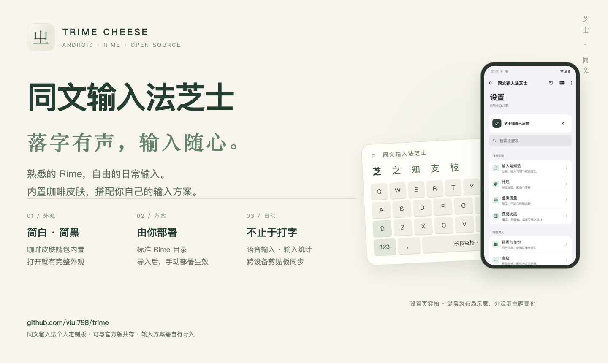

<!--
SPDX-FileCopyrightText: 2015 - 2024 Rime community
SPDX-FileCopyrightText: 2026 Zhi Trime contributors

SPDX-License-Identifier: GPL-3.0-or-later
-->

<p align="center"><b>简体中文</b></p>

<p align="center">
  <a href="https://github.com/viui798/trime/releases/latest"></a>
</p>

<p align="center">
  同文输入法 Trime 的个人定制版。装完自带完整外观，方案自己导入，部署你说了算。
</p>

<p align="center">
  <a href="https://github.com/viui798/trime/releases/latest"></a>
  <a href="LICENSE"></a>
  <a href="https://github.com/osfans/trime"></a>
  <a href="https://github.com/viui798/trime/releases"></a>
</p>

<br>

<a id="download"></a>
<h3 align="center">下载</h3>

<p align="center">从 GitHub Releases 取最新 APK，绝大多数手机选 <b>arm64-v8a</b>。</p>

<p align="center">
  <a href="https://github.com/viui798/trime/releases/latest"></a>
</p>

<p align="center">
  <sub>包名 <code>com.viui.trime.cheese</code>，可与官方同文同时安装，互不影响。</sub><br>
  <sub>Release 附 <code>SHA256SUMS.txt</code> 可核对完整性；换签名或从官方版切换时不能直接覆盖安装。</sub>
</p>

<br>

<h3 align="center">内置一套完整的咖啡皮肤</h3>

<p align="center">皮肤「<b>咖啡芝士默认</b>」随安装包一起进：简白、简黑两套配色，14 张按键背景图也打包好了，新装打开就是一个完整键盘。</p>

<p align="center">咖啡皮肤的按键底色全部来自图片而不是色值，所以只内置 yaml 不够——两套配色实际用到的图都在 APK 里，只多 36 KB。</p>

<br>

<h3 align="center">没有方案，也会告诉你</h3>

<p align="center">空格键明确显示「未导入方案」，不会让你对着一个没反应的键盘猜。外观不受影响，主题、配色、按键底色都随 APK 内置。</p>

<br>

<h3 align="center">一个标准 Rime 目录</h3>

<p align="center">方案、主题、词库、学习数据都在根目录，和桌面版 Rime 一样。文件管理器改完，部署一下就生效。</p>

<p align="center"><code>build/</code> 存放部署产物；部分方案只有预编译词典，请勿随意删除。备份建议停用输入法后完整复制 Rime 目录，保留方案、用户词典 <code>*.userdb</code> 与 <code>sync/</code>。</p>

<p align="center">从旧版升级时，旧分类目录会迁移到根目录，已有文件优先保留；冲突与剩余内容留在 <code>cheese/legacy/</code>，请保留以便核对。</p>

<br>

<h3 align="center">导入不自动部署</h3>

<p align="center">导入只做「把文件放到位置」，什么时候部署由你决定。导完一个大词库不会突然卡住几分钟。</p>

<br>

<h3 align="center">数据放哪，你选</h3>

<p align="center">外部目录直接用、SAF 同步、应用专属空间，三种模式互斥，随时切换。切换只走一条安全通道：停引擎、准备目录、复制、保存设置；引擎启动中或部署中不允许切。</p>

<br>

<h3 align="center">引擎会自己爬起来</h3>

<p align="center">存储不可用时，键盘可能显示但无法输入。本版在唤起输入法时检查引擎状态并尝试恢复；若外部目录权限失效，需先重新授权，必要时手动部署。</p>

<br>

## 相比之下改了什么

| | 芝士版的做法 |
| --- | --- |
| **默认外观** | 内置咖啡主题与按键背景图，新装不用先折腾皮肤 |
| **方案** | 预置方案全部删除，导入支持 `.zip` 和散装的 `.schema.yaml` / `.dict.yaml` / `.lua` / `.trime.yaml` |
| **部署** | 导入后不自动部署，入口在方案页 / 外观页右下角 `+` |
| **存储** | 传统 Rime 根目录，三种模式可选，切换时目标同名文件优先保留、旧目录不删 |
| **引擎** | 弹出输入法时检查状态，停摆自动重启（失败按 2 秒间隔重试） |
| **键盘** | 底行 `'` 换成中文逗号 `，`（长按句号）；功能键标签简繁统一；默认开启震动 |
| **语音** | 内置通义千问、豆包、腾讯识别 / 翻译四个 JS 插件，也能导入第三方 `.js` |
| **输入统计** | 输入速度、生涯段位与键盘热力，可生成图片分享 |
| **剪贴板同步** | 多设备互通，支持多种服务端类型，可按文本长度、后缀、大小做接收过滤 |

语音输入需麦克风权限、网络及所选服务的凭据，并需授权插件访问其声明的域名；剪贴板同步需配置兼容的服务端。两者都不是安装后自动启用的离线功能。

## 安装

1. 到 [Releases](https://github.com/viui798/trime/releases/latest) 下载对应架构的 APK，常见手机选 **arm64-v8a**。
2. 允许安装后，到「设置 → 语言和输入法」启用「同文输入法芝士」并设为默认输入法。
3. 导入你的输入方案，再点方案页右下角 `+` 里的**部署**。咖啡皮肤已内置，其他皮肤可按需导入。

| 项目 | 当前安装包 |
| --- | --- |
| 应用名 | 同文输入法芝士 |
| 包名 | `com.viui.trime.cheese` |
| 版本 | `1.2.11-cheese` / versionCode 21 |
| 系统 | Android 5.0 及以上；语音识别需 Android 6.0+（QuickJS 限制） |
| 架构 | arm64-v8a、armeabi-v7a、x86、x86_64（模拟器） |
| 体积 | 约 7.2 MB |

## 常见问题

<details>
<summary><b>主题名没变成「咖啡芝士默认」？</b></summary>
<br>

主题文件的查找顺序是「用户数据目录 → APK 内置」。你导入的皮肤同名文件会优先于内置主题——这是预期行为。想回到内置默认，把用户目录里同名的 `咖啡*.trime.yaml` 和 `咖啡配色.yaml` 挪走即可。

</details>

<details>
<summary><b>导入方案后打不出字？</b></summary>
<br>

导入不会自动部署。到「方案」页右下角 `+` 里点**部署**，部署完成才能用；大词库首次部署需要几分钟，请留在页面。

</details>

<details>
<summary><b>键盘能弹出来，但完全没反应？</b></summary>
<br>

多半是存储权限被撤销过。本版会自动重启引擎，权限恢复后重新点一下输入框；如果仍无反应，去「数据与备份」确认目录权限，再手动部署一次。

</details>

<details>
<summary><b>可以和官方同文一起装吗？</b></summary>
<br>

可以。包名是 `com.viui.trime.cheese`，与官方同文互不影响，两套输入法的方案、词库和主题各自独立。

</details>

<details>
<summary><b>为什么不预置输入方案？皮肤需要自己装吗？</b></summary>
<br>

预置方案体积大且多数人用不到。删掉后安装包更小，你导入什么就是什么；外观方面内置了主题和按键背景图，所以新装打开也是一个完整键盘。

</details>

<details>
<summary><b>支持哪些架构？</b></summary>
<br>

arm64-v8a（绝大多数手机）、armeabi-v7a（老 32 位 ARM）、x86 / x86_64（模拟器）。32 位 ARM 构建前必须先打 lua 补丁，见下方源码构建。

</details>

## 更新记录

### 1.2.11 · 工具栏误触修复

- 修复：手指按在工具栏上、抬起前候选栏正好顶掉工具栏时，残留触摸会误触发工具栏按钮（摘取上游 `e1e0ece9`）
- 关于页简介改为「落字有声，输入随心。熟悉的 Rime，自由的日常输入；内置咖啡皮肤，搭配你自己的输入方案。」
- 移除已失效的「方案目录」入口（传统布局下点开必然提示「还没有导入方案包」）

### 1.2.10 · 图标与外部目录页面优化

- 缩小桌面图标的「㞢」字，增加留白；更新五档图标资源
- 外部目录管理页统一卡片布局、输入框与权限状态，修正状态栏避让
- 关于页修正内置皮肤说明，补充输入统计、语音与剪贴板同步致谢和链接
- README 更换主图，修正安装、备份与功能说明

### 1.2.9 · 内置咖啡皮肤，装完即有完整外观

- 内置皮肤「咖啡芝士默认」：主题 + 14 张按键背景图（共 36 KB），修复新装「按键没有底色块、回车键淡到看不见」
- 配色精简为简白 / 简黑两套；没有方案时空格键明确显示「未导入方案」
- 应用图标换成「㞢」宣纸墨印，右下角带「芝」字水印
- 删除早已失效的「方案目录」入口（传统布局下它必然弹「还没有导入方案包」）

### 1.2.8 · 修复切换主题必失败

主题列表与磁盘文件不一致时的崩溃与切换失败问题。

### 1.2.7 · 引擎自愈 + 手动部署

- 引擎自愈：弹出输入法时检查状态，停摆自动重启
- 导入不自动部署，导完大词库不会突然卡住几分钟
- 字体缓存、绘制路径、界面重建三处性能修复：连打 20 键卡顿帧从 60% 降到 22%

更早的版本见 [Releases](https://github.com/viui798/trime/releases)。

## 从源码构建

需要 JDK 21、Android SDK（platform 37 / build-tools 37.0.0）、NDK 30、CMake 3.31.6。

```bash
git clone --recursive https://github.com/viui798/trime.git
cd trime

# 32 位 ARM 必须先打 lua 补丁，否则 lua 5.4 报 fseeko 未声明
git apply --directory=app/src/main/jni/librime-lua-deps patches/lua.patch
git apply --directory=app/src/main/jni/librime patches/rime-userdirs.patch

./gradlew app:assembleRelease     # 产物在 app/build/outputs/apk/release/
```

首次构建会下载 Boost 并现场编译 librime，比较慢；之后改 Kotlin / 资源都是增量。Release 包需要用你自己的密钥 zipalign + apksigner 签名，发布私钥不在仓库里。

## 目录

| 路径 | 内容 |
| --- | --- |
| `app/src/main/java/` | Kotlin 实现（输入法服务、设置、主题、同步） |
| `app/src/main/assets/shared/` | 内置主题与按键背景图 |
| `app/data/rime/` | Rime 与方案子模块 |
| `app/src/main/jni/` | librime 及原生依赖 |
| `patches/` | 构建补丁（32 位 lua、Rime 用户词典目录） |

## 致谢与许可

这个版本站在很多人的肩膀上：

- **[osfans/trime](https://github.com/osfans/trime)**：同文输入法上游，本项目的全部基础（GPL-3.0-or-later）
- **[rime/librime](https://github.com/rime/librime)**、**[BYVoid/OpenCC](https://github.com/BYVoid/OpenCC)**：输入引擎与简繁转换
- **[咩版同文](https://github.com/qxm888/trime-mie)**（qxm888）：感谢输入统计功能的开源实现，芝士版的输入统计由此移植；存储布局与手动部署交互也参考了咩版
- **[中州鹅](https://github.com/SandyYuR/fcitx5-android)**（SandyYuR）：感谢语音输入与剪贴板同步相关的开源实现
- **[fxliang](https://github.com/fxliang)**：感谢语音输入与剪贴板同步相关的开源贡献
- **Rime 与同文社区**的方案作者、皮肤作者、字体作者，以及所有提过 issue、反馈过问题的朋友

本项目沿用 **GPL-3.0-or-later**，与上游一致。修改自用没问题，再分发请同样开源。主题、皮肤、字体与词库素材的权利归各自作者所有。

<p align="center"><sub>这是一个个人定制版，不承诺功能完整性与问题响应速度；完整社区支持请看上游。与同文官方、Rime 官方均无隶属关系。</sub></p>
