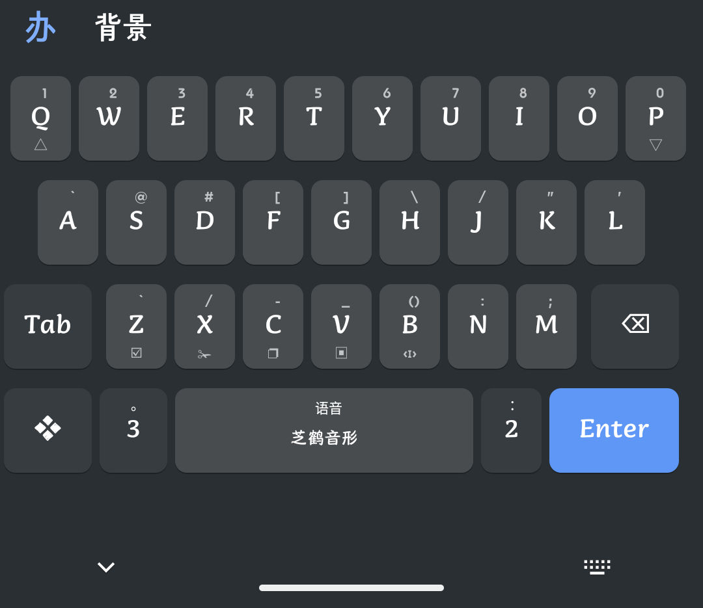
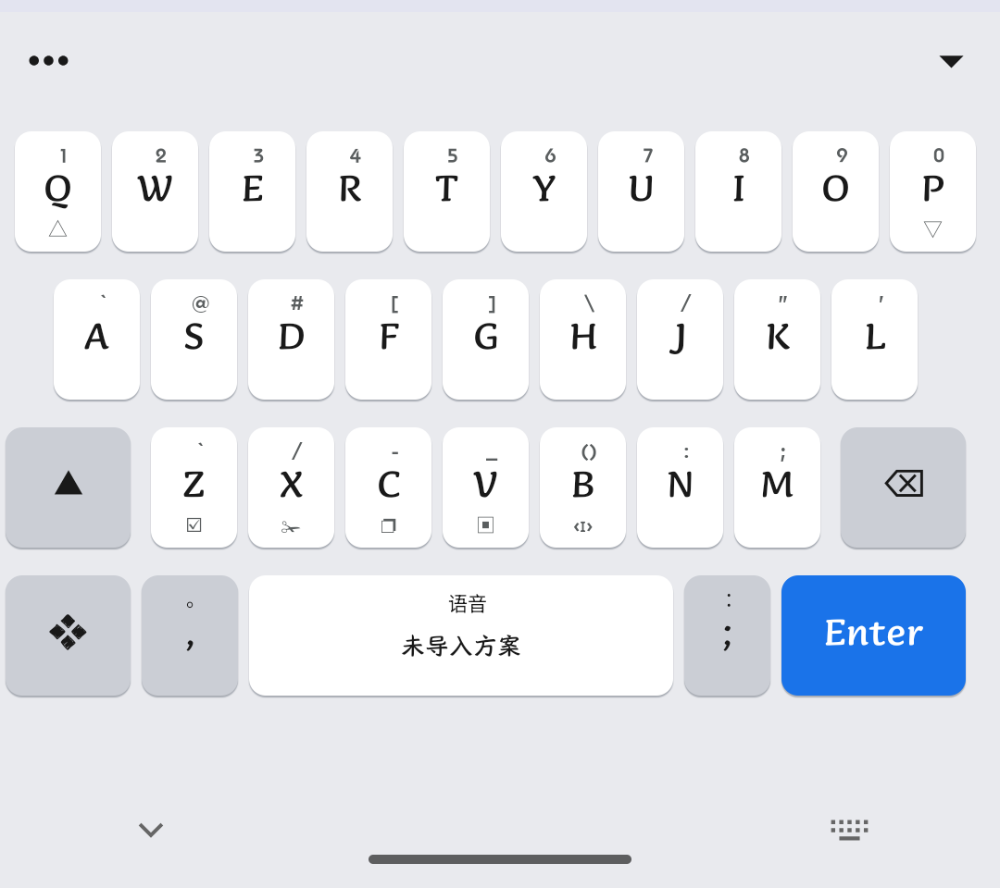
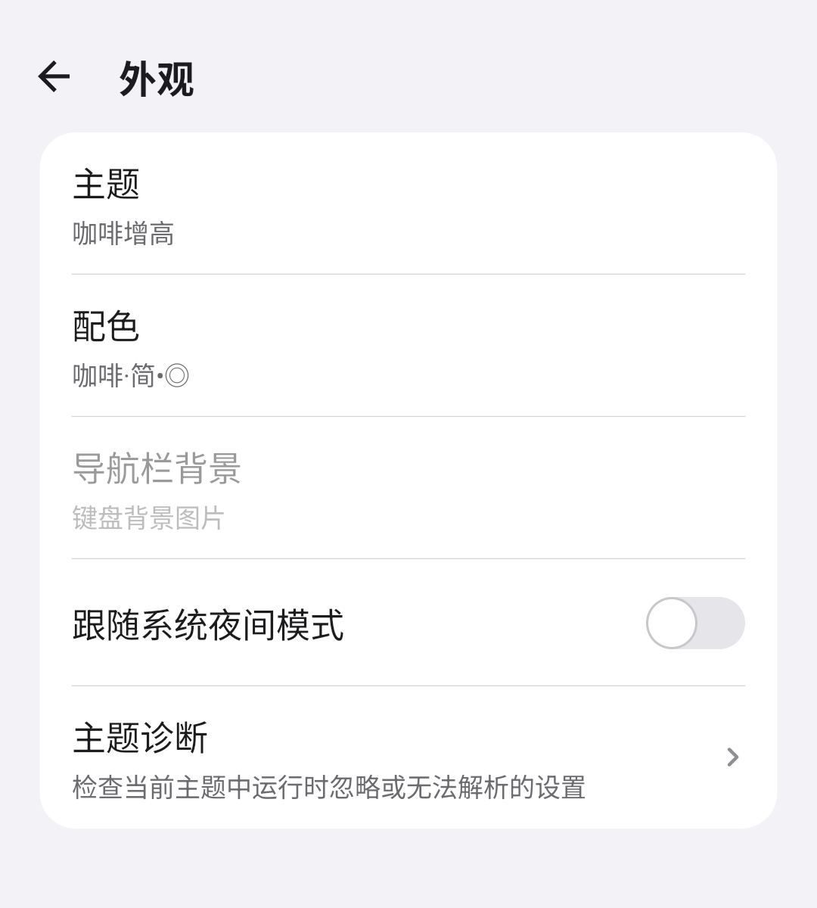
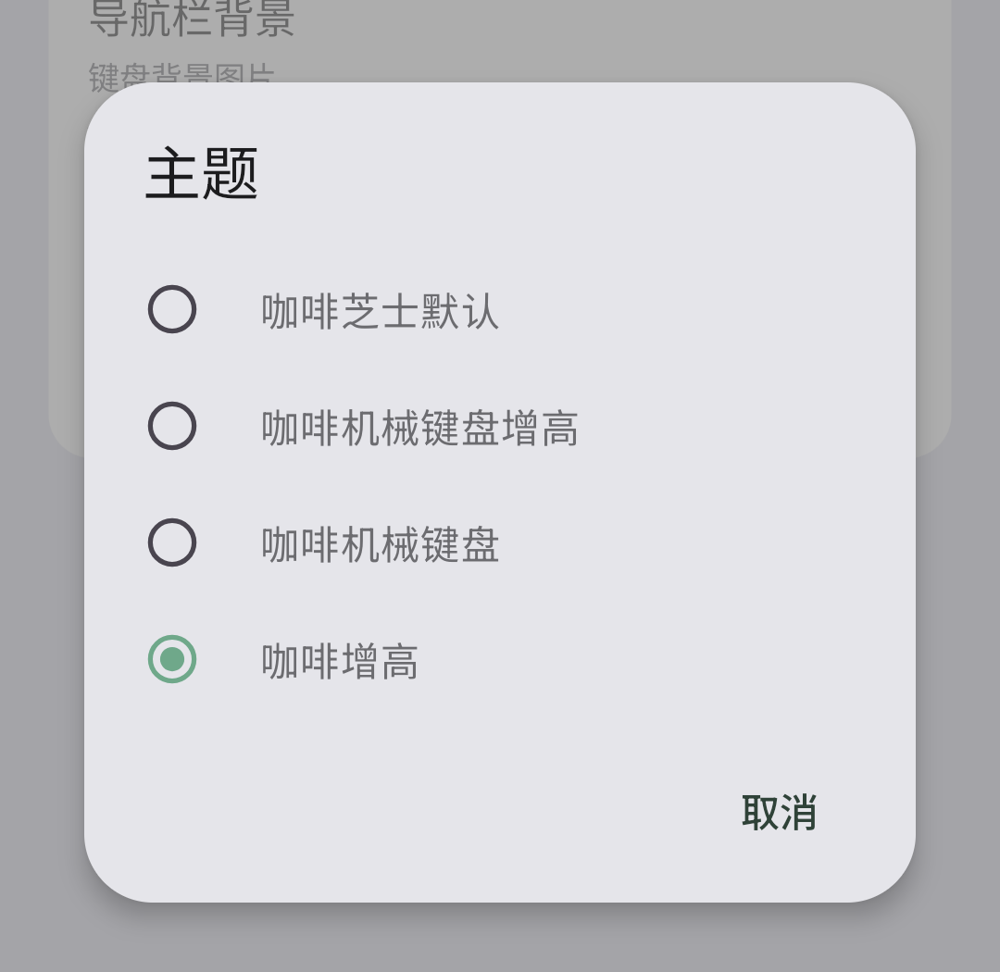
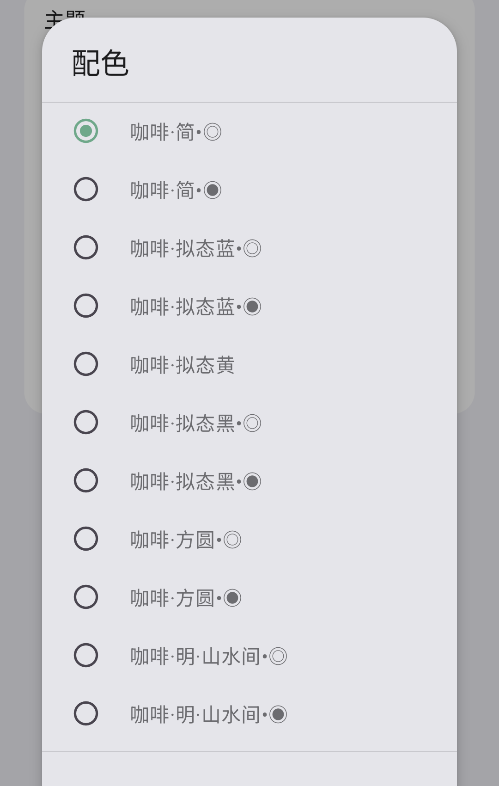
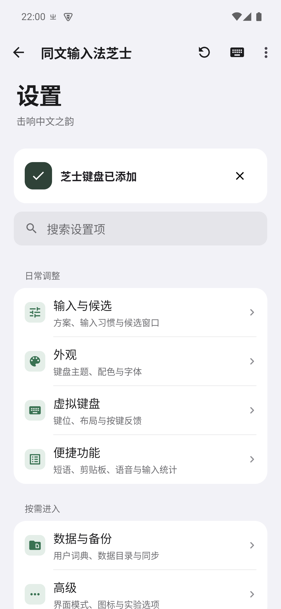

<!--
SPDX-FileCopyrightText: 2015 - 2024 Rime community
SPDX-FileCopyrightText: 2026 Zhi Trime contributors

SPDX-License-Identifier: GPL-3.0-or-later
-->

# 同文输入法芝士 · Trime Cheese

[](https://github.com/viui798/trime/releases/latest)

基于 [同文 Trime](https://github.com/osfans/trime) 与 Rime 的 Android 输入法个人定制版。保留方案、词库和 YAML 主题生态，重做导入与存储流程：**装完不塞方案，导入和部署你说了算**，外部存储想怎么放就怎么放。

包名 `com.viui.trime.cheese`，**可以和官方同文同时安装**，互不影响。

[**下载最新版**](https://github.com/viui798/trime/releases/latest) · [所有版本](https://github.com/viui798/trime/releases) · [问题反馈](https://github.com/viui798/trime/issues)

> 当前源码版本：**1.2.9-cheese**（versionCode 19），正式 APK 约 7.3 MB，已在 [Releases](https://github.com/viui798/trime/releases/latest) 发布，附 `SHA256SUMS.txt` 可核对完整性。

---

## 更新记录

### 1.2.9 · 装完就有完整外观

- 内置 **「咖啡芝士默认」主题**与 14 张按键背景图（共 36 KB）：新装不再出现
  「按键没有底色块、回车键淡到看不见」的裸文字键盘
- 配色精简为 **简白 / 简黑** 两套；没有方案时空格键明确显示「未导入方案」
- 应用图标换成 **「㞢」宣纸墨印**，右下角带「芝」字水印
- 外部目录管理页状态提示改用独立样式

### 1.2.8 · 修复切换主题必失败

主题列表与磁盘文件不一致时的崩溃与切换失败问题。

### 1.2.7 · 引擎自愈 + 手动部署

- **引擎自愈**：上游在存储权限被撤销（卸载重装必然发生）后引擎启动被跳过，键盘能弹但
  完全没反应。本版每次弹出输入法都检查引擎状态，停摆自动重启
- **导入不自动部署**：导入只做「把文件放到位」，要不要部署、什么时候部署由你决定
  （与咩版一致），导完大词库不会突然卡住几分钟
- 字体缓存、绘制路径、界面重建三处性能修复：连打 20 键卡顿帧 60% → 22%

### 1.2.6 · 数据目录改版

用户数据分成五个平级目录（`方案/`、`皮肤/`、`部署/`、`学习/`、`运行数据/`），
方案包零复制、学习数据全局共享；更早版本见 [Releases](https://github.com/viui798/trime/releases)。

---

## 截图

<p>
  
  
  
</p>

<p>
  
  
  
</p>

*图为模拟器实拍：简白 / 简黑配色为内置默认；「芝鹤音形」方案与咖啡系列皮肤为用户自行导入。*

---

## 这一版做了什么

### 装完是空的：方案和皮肤都由你自己导入

上游预置了一堆拼音方案和两套皮肤，这个版本**全部删掉**。首次启动向导的第 2、3 步
就是导入：支持打包好的 `.zip`，也支持散装的 `.schema.yaml` / `.dict.yaml` / `.lua` /
`.trime.yaml`。错过向导也没关系，「设置 → 方案」在没有方案时会直接给一个「导入方案…」按钮。

> 一个方案都不导入也能用键盘，但打不出字——空格键会明确显示「未导入方案」，
> 不会让你对着一个没反应的键盘猜。外观不受影响：主题、配色、按键底色都随 APK 内置。

### 导入后不会自动部署，部署你说了算

导入只做「把文件放到位 + 提示导入成功」，**要不要部署、什么时候部署由你决定**。
部署入口在方案页 / 外观页右下角的 `+` 里。

### 数据放哪，你选

向导里三种模式，互斥：

| 模式 | 说明 |
| --- | --- |
| **直接使用外部目录**（旧版方式） | 数据放在共享存储（默认 `/storage/emulated/0/rime-cheese`），文件管理器直接改，需授予「所有文件访问」 |
| **从外部存储同步** | 走 SAF 选一个目录，双向同步 |
| **使用应用专属空间** | 放在应用私有目录，最省心 |

选「直接使用外部目录」时还有一个独立的管理页：查看/授予权限、改路径、一键切换
（切换时补齐旧目录的数据；目标目录已有的同名文件优先保留，旧目录不删）。

### 键盘上的改动

- 底行把用处不大的 `'` 换成中文逗号 `，`，长按为句号 `。`
- 功能键标签简繁统一（上游皮肤里「剪切/复制/粘贴/时间/隐藏」等 53 处是繁体）
- 默认开启按键震动
- 长按空格（或语音键）录音时，候选栏位置变成波形条，边说边把中间结果写进输入框

### 额外加的功能

- **语音识别**：内置通义千问（阿里百炼）、豆包（火山引擎）、腾讯云（识别 / 翻译）
  四个 JS 插件，填自己的 API Key 即可；也支持导入第三方 Foxy 语音插件。
  录音只发往插件声明的域名，Key 用 Android Keystore 加密，不交给脚本。
- **输入统计**：今日字数 / 上屏次数、累计、最近 7 天柱状图。
- **快捷短语**：直接编辑 Rime 用户目录的 `custom_phrase.txt`。
- **剪贴板同步**：多设备剪贴板互通（需自行配置服务端）。

---

## 下载与安装

1. 到 [Releases](https://github.com/viui798/trime/releases/latest) 下载对应架构的 APK，
   同目录的 `SHA256SUMS.txt` 可核对完整性。
2. 允许安装后，到「设置 → 语言和输入法」启用「同文输入法芝士」并设为默认输入法。
3. 导入你的方案与皮肤并部署。

| 项目 | 当前安装包 |
| --- | --- |
| 应用名 | 同文输入法芝士 |
| 包名 | `com.viui.trime.cheese`，可与官方同文共存 |
| 版本 | `1.2.9-cheese` / versionCode 19 |
| 系统 | Android 5.0 及以上；语音识别需 Android 6.0+（QuickJS 限制） |
| 架构 | **arm64-v8a**（绝大多数手机）、armeabi-v7a、x86、x86_64（模拟器） |
| 体积 | 约 7.3 MB |

### 升级提示

主题文件的查找顺序是**用户数据目录优先于 APK 内置**。若你的用户目录里残留旧版
`咖啡*.trime.yaml` / `咖啡配色.yaml`，它们会盖住内置的「咖啡芝士默认」主题——
升级后主题名没变，把这些旧文件挪走即可。

## 数据目录

「应用专属空间」模式下：

```
files/rime/
├── 方案/        输入方案源文件，一个包一个文件夹
├── 皮肤/        键盘皮肤源文件
├── 部署/        Rime 编译产物，删了会重新生成
├── 学习/        词频、用户词典（*.userdb）和同步快照
└── 运行数据/    Rime 引擎读取的目录，别手动改
```

选「直接使用外部目录」时这套结构原样搬到你指定的共享存储目录。

几个要点：

- **包就是纯源**：导入时会丢掉包里自带的 `*.userdb`、`user.yaml`、`installation.yaml`
  以及其它平台的学习数据，不会覆盖你自己的词频。
- **预编译词典会保留**：芝鹤这类包没有 `.dict.yaml` 源，词典只在 `build/*.bin` 里。
  应用会把它们收进包内 `.prebuilt/`，部署前再放进 `部署/`。
- **部署产物和学习数据分开放**：`部署/` 可以随时删；`学习/` 单独备份就能带走词频。
- 「运行数据」存在是因为 Rime 只在数据目录**根**上找方案、不认子目录，源文件要摊平一份给它读。

## 从源码构建

需要 JDK 21、Android SDK（platform 37 / build-tools 37.0.0）、NDK 30、CMake 3.31.6。

```bash
git clone --recursive https://github.com/viui798/trime.git
cd trime

# 32 位 ARM 必须先打 lua 补丁，否则 lua 5.4 报 fseeko 未声明
git apply --directory=app/src/main/jni/librime-lua-deps patches/lua.patch

./gradlew app:assembleRelease     # 产物在 app/build/outputs/apk/release/
```

首次构建会下载 Boost 并现场编译 librime，比较慢；之后改 Kotlin / 资源都是增量。

---

## 致谢与许可

- 上游：[osfans/trime](https://github.com/osfans/trime)（GPL-3.0-or-later），本项目的全部基础
- 引擎：[rime/librime](https://github.com/rime/librime)、[BYVoid/OpenCC](https://github.com/BYVoid/OpenCC)
- 皮肤与交互取舍参考了同文社区和 [咩版 trime-mie](https://github.com/qxm888/trime-mie)

本项目沿用 **GPL-3.0-or-later**，与上游一致。修改自用没问题，再分发请同样开源。

> 这是一个个人定制版，不承诺功能完整性与问题响应速度；完整社区支持请看上游。
